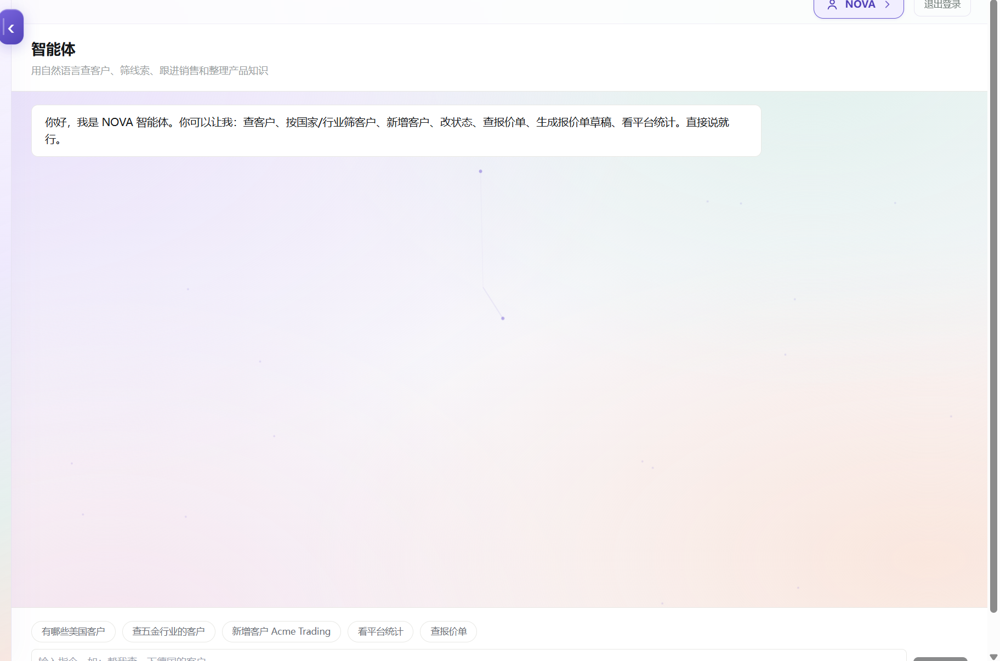
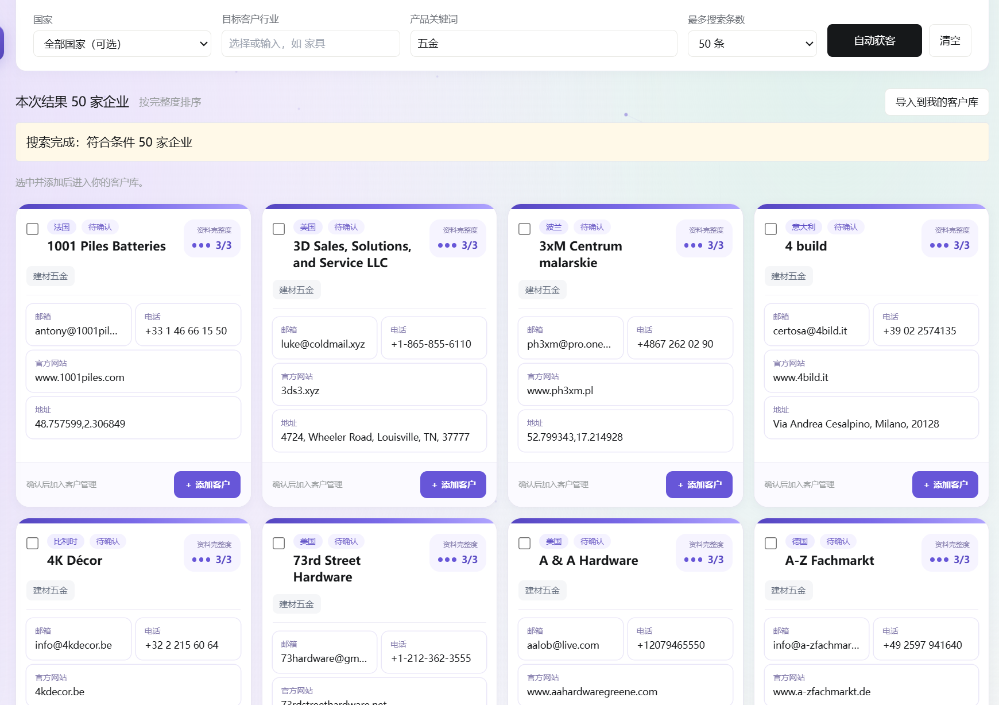

<div align="center">
  
  <h1>NOVA 外贸 CRM</h1>
  <p><strong>把客户线索、销售跟进、跨渠道沟通与出口报价连接到同一工作流程。</strong></p>
  <p>为外贸企业和销售团队打造的客户关系管理与业务协作平台</p>
</div>

---

## 关于 NOVA

外贸业务往往分散在表格、邮箱、社交平台和个人跟进记录中。NOVA 将客户资料、销售阶段、消息处理、报价准备和团队协作集中在一个工作空间，让团队更容易了解客户从哪里来、目前推进到哪一步、下一步应该做什么。

NOVA 面向需要管理国际客户和出口销售流程的企业。团队可以按国家、行业、产品和销售阶段整理客户，汇总日常待办与询盘表现，并在权限范围内协同维护业务信息。系统支持部署到企业自有服务器，使用企业自己的域名和 HTTPS 访问。

## 从线索到成交的工作流程

1. **发现潜在客户：**通过 AI 获客按产品关键词、国家或行业查找企业资料。
2. **建立客户档案：**将合适线索加入客户库，补充联系人、联系方式、行业和地区信息。
3. **安排销售跟进：**按线索、已联系、已报价、谈判中、样品中、成交等阶段推进客户，并查看待跟进与高意向事项。
4. **处理客户沟通：**连接支持的社媒与邮箱渠道，在消息工作台查看会话、识别待回复事项并准备回复。
5. **准备出口报价：**结合订单数量、成本、物流费用、汇率、贸易术语和目标利润估算报价。
6. **复盘团队进展：**通过总览、趋势图和转化漏斗了解询盘规模及各阶段的推进情况。

## 产品界面与功能

### 工作总览


总览页将今日新增客户、待跟进、待处理回信、报价单、成交和客户总量放在同一视图，并提供邮箱与 WhatsApp 联系覆盖情况及外贸汇率参考。团队负责人可据此快速判断工作负荷和需要优先处理的事项。

### AI 智能体



智能体支持通过自然语言发起常见 CRM 操作，例如查询客户、按国家或行业筛选、创建客户、调整阶段、查询报价及查看统计。它将常用查询和操作集中到对话入口，减少重复导航；具体可执行范围受账户权限和已配置服务约束。

### 客户管理与销售阶段


客户档案可记录公司名称、国家地区、行业、联系人、职位、邮箱、WhatsApp、电话、官网和地址等信息。用户可搜索客户、创建和编辑档案，并更新销售阶段。阶段分类帮助团队区分新线索、已联系、已报价、谈判中、样品中、成交和流失客户，减少客户资料散落在个人表格中的情况。

### AI 获客



输入产品关键词，可选国家、目标客户行业和结果数量，浏览匹配企业的基础资料与联系方式。团队可筛选合适线索并将其加入自己的客户库，再开展人工核实和后续联系。搜索结果属于企业线索资料，并不代表对方当前有采购需求；联系前应自行确认资料时效性及适用的隐私和营销规则。

### 社媒与邮箱渠道


在统一页面管理 WhatsApp、Facebook、Instagram、Gmail、企业邮箱和 LinkedIn 等渠道连接。管理员配置团队共用的社媒服务接入信息，团队成员分别绑定自己负责的账号；邮箱连接按用户独立设置。不同渠道的可用功能取决于授权范围、服务商配置及平台政策。

### 消息工作台


消息工作台按渠道整理客户会话，支持搜索客户、号码或消息内容，并筛选待回复和已回复会话。用户可查看会话关联的客户资料、阅读历史消息、准备并发送回复，也可使用翻译和 AI 起草辅助撰写。自动回复等能力需按部署配置启用，发送能力以实际渠道授权和连接状态为准。

### 销售工作台与询盘转化


销售工作台汇总今日待跟进、高意向客户、待回复消息和本月已接受报价额。看板按销售阶段展示客户卡片，并提供询盘趋势与转化漏斗，帮助团队观察线索如何从初次沟通推进到报价、样品和成交。负责人可据此发现需要补充跟进或进一步分析的阶段。

### 报价与利润计算器


报价计算器可录入订单数量、产品出厂成本、包装成本、验货成本、国内运输、报关及单证、港杂、海运费、银行费用、汇率、贸易术语、销售佣金、保险费率和目标毛利率，并估算建议单价、订单总报价、计入成本和预计毛利。计算结果用于报价准备；实际报价仍需根据供应商价格、合同约定、汇率、物流及其他适用费用复核。

### 登录界面


## 团队与账户管理

管理员可在 `/team` 创建员工账户、设置或重置密码，并按岗位分配可访问的功能模块。成员使用自己的账户开展工作，按分配权限访问系统。邮箱连接按用户分别配置；公司社媒服务配置由管理员维护，团队成员各自绑定工作账号。客户业务数据按账户隔离，团队概览用于查看本团队范围内的业务情况。

## 部署方式

NOVA 支持部署在企业自有 Linux 服务器上，企业通过自己的域名和 HTTPS 访问。部署指南 [`SELF-HOSTING.md`](SELF-HOSTING.md) 介绍 Docker Compose、初始化授权、管理员账户、反向代理、持久化数据、备份和升级流程。

部署前需准备 Linux 服务器、Docker Compose、公网域名、HTTPS 反向代理和 NOVA 管理员提供的首次授权信息。默认应用容器端口为 `3000`，Compose 将服务绑定到服务器本机回环地址，再由 Nginx 或 Caddy 代理公网 HTTPS 请求。

```bash
cp .env.example .env
# 根据 SELF-HOSTING.md 配置域名及初始化参数
docker compose up -d --build
```

升级前应备份 `.env`、数据库和持久化数据卷，并按部署指南保留数据卷。不要将生产密钥、数据库、备份或 `.env` 文件提交到公开仓库。

## 外部服务与使用边界

- WhatsApp 扫码授权通过 NOVA 配置的主站中转服务完成；部署方需确保该服务可用。
- AI 获客使用 NOVA 提供的共享企业资料搜索服务；数据更新后重新搜索即可查询新匹配结果。
- Facebook、Instagram、LinkedIn、Gmail、企业邮箱及 AI 模型能力需要部署方或用户配置相应账户、服务和授权。
- 真实消息收发依赖第三方平台授权、可用的公网 HTTPS 回调和正确的渠道配置。界面截图展示产品页面，不应解读为某个外部账号已完成实时生产验收。
- 外贸汇率及海关统计等信息用于业务参考；交易决策请结合权威来源和实际合同核实。

## 技术栈

Next.js 15、React 19、TypeScript、SQLite、Docker Compose 和 Node.js 22。

## 许可证与品牌

本项目采用 [MIT License](LICENSE)，允许复制、修改、部署、再分发及商用；再分发时须保留版权声明和许可证文本。第三方依赖、字体、图标、图片和外部服务仍遵守各自的许可证或服务条款。

NOVA 名称及 Logo 作为品牌素材使用。版权方：KUMIiun · [manshuang920@gmail.com](mailto:manshuang920@gmail.com)


## 切割版免授权更新（2026-11-23）
部署后直接创建管理员并登录，无需主站授权码、域名许可、审批或续期。员工由公司管理员创建。仅共享采集库获客与 WhatsApp 扫码使用主站服务，其余社媒、邮箱、AI 模型自行配置。不含平台管理、主站密钥或原始采集库。主站需部署兼容自助身份验签的新版共享接口。


## 2026-11-23 主题与智能体模型更新
修复报价结果卡文字对比度，销售工作台图表和获客卡片随五种主题切换。智能体输入区支持模型选择与自定义模型 ID，沿用个人设置中的接口及 API Key，选择按用户保存，并用于当前对话的所有工具调用轮次。模型需由所配置接口支持。
切割版继续无需 NOVA 授权码，直接创建管理员登录；仅共享采集库获客和 WhatsApp 使用主站服务，其他社媒、邮箱和模型自行配置。不包含平台管理、主站密钥或原始采集库。
