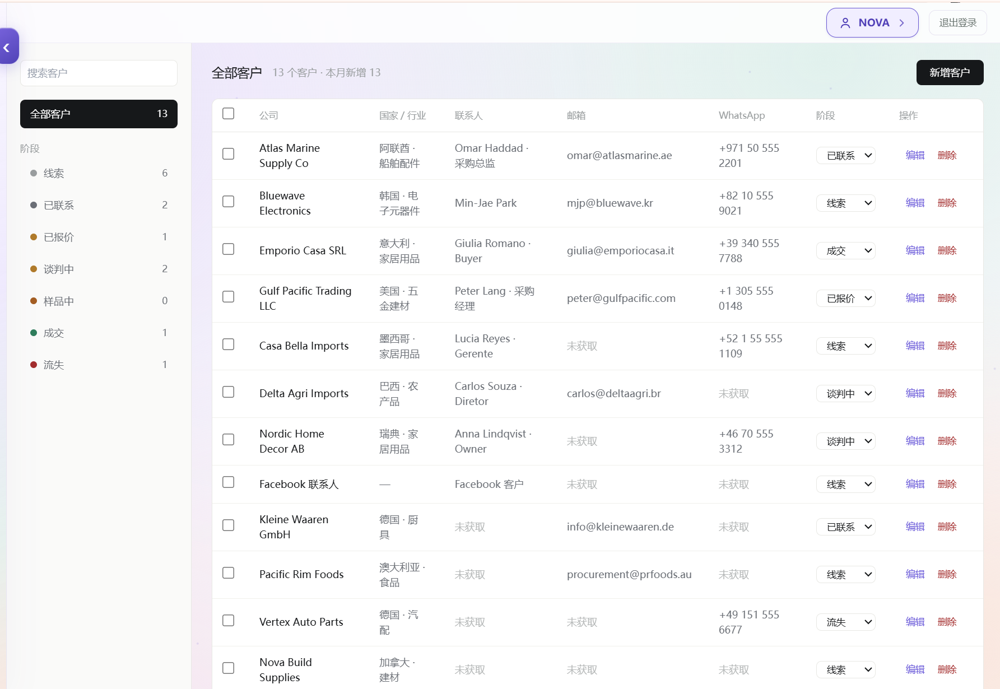
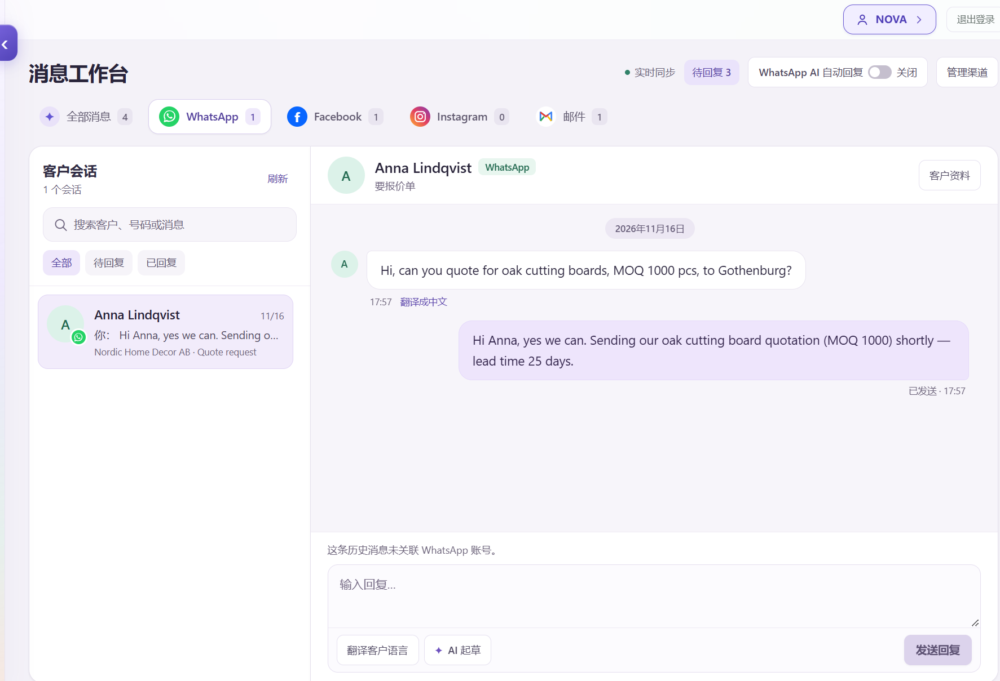
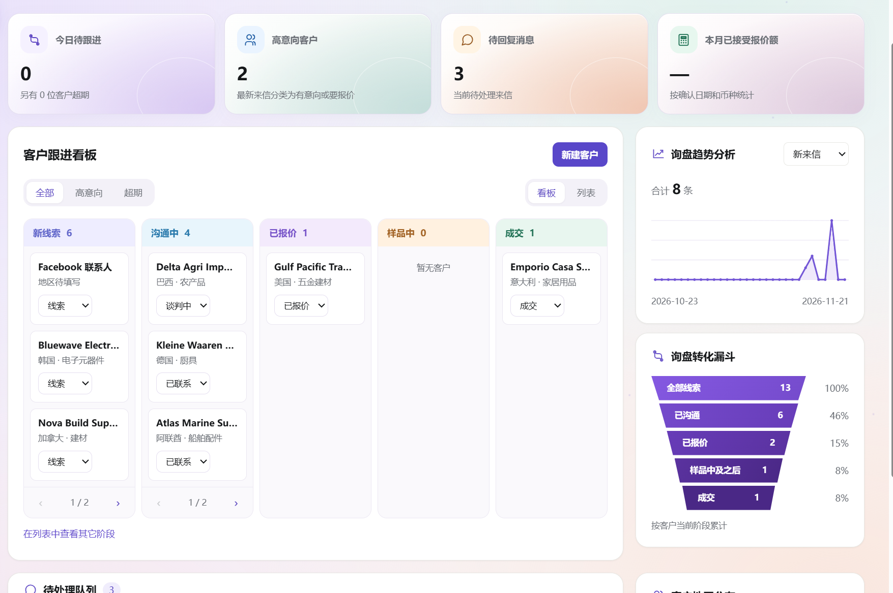
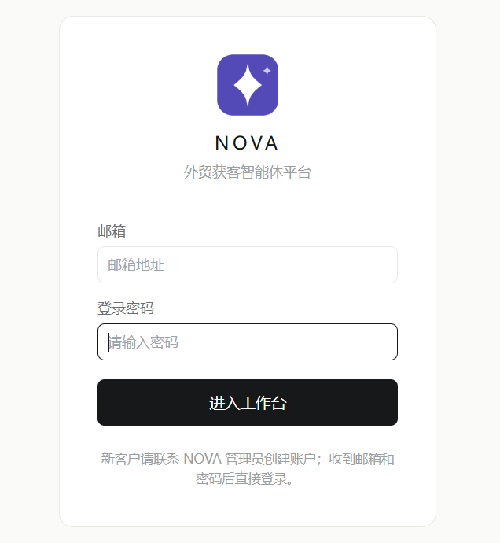

<div align="center">
  
  <h1>NOVA 外贸 CRM</h1>
  <p><strong>客户管理、销售跟进、获客与多渠道沟通的一体化工作平台</strong></p>
</div>

## 产品功能与界面

### 1. 工作总览


总览页集中显示今日客户新增、待跟进、待处理回信、报价单、成交和客户总数，并呈现邮箱与 WhatsApp 联系覆盖情况及汇率参考，便于团队快速掌握日常工作重点。

### 2. AI 智能体


通过自然语言查询客户、按国家或行业筛选、创建客户、调整跟进状态、查询报价和查看统计。常用任务可从同一入口发起，减少页面切换。

### 3. 客户管理与销售阶段



客户管理用于维护企业、国家地区、行业、联系人、邮箱、WhatsApp 和销售阶段；支持搜索、创建、编辑和更新阶段，便于团队持续维护客户档案并推进商机。

### 4. AI 获客


按产品关键词发现企业线索，可选目标国家、行业和结果数量；查看企业资料后，可将选中的记录导入客户库继续跟进。企业名录用于线索发现，不代表对方当前存在采购意向。

### 5. 社媒与邮箱渠道


统一管理 WhatsApp、Facebook、Instagram、Gmail、企业邮箱和 LinkedIn 等连接。具体连接与消息能力取决于账号授权、服务配置及第三方平台权限。

### 6. 消息工作台



按渠道浏览会话、搜索客户或消息、筛选待回复与已回复，并在同一页面阅读和回复。支持查看会话关联的客户资料，并使用翻译和 AI 起草辅助准备回复。

### 7. 销售工作台与询盘转化



工作台汇总今日待跟进、高意向客户、待回复消息和已接受报价额。看板按销售阶段组织客户，侧栏提供询盘趋势及从线索到成交的转化漏斗，帮助团队识别阶段进展和跟进重点。

### 8. 报价与利润计算器


录入订单数量、产品及包装成本、国内运输、报关和港杂等出口费用、汇率、贸易术语、佣金及目标毛利率，估算建议单价、订单报价和预计利润。正式报价应再按实际合同、实时汇率及物流费用核算。

## 登录界面



## 团队协作

管理员可在 `/team` 创建员工、重置密码并分配模块权限。员工使用个人账号工作，邮件连接按用户独立配置；公司社媒接入配置由管理员统一管理，团队成员分别绑定自己的渠道账号。

## 部署与外部服务

NOVA 支持部署在企业自有 Linux 服务器，通过企业域名和 HTTPS 访问。部署、首次初始化、备份与升级请参阅 [`SELF-HOSTING.md`](SELF-HOSTING.md)。默认应用容器端口为 `3000`，建议由 Nginx 或 Caddy 代理 HTTPS 请求。

```bash
cp .env.example .env
# 按 SELF-HOSTING.md 配置域名与初始化参数
docker compose up -d --build
```

WhatsApp 授权中转和 AI 获客共享搜索依赖 NOVA 主站服务。社媒、邮箱和 AI 模型功能需配置相应账号与授权；真实收发还依赖可达的公网 HTTPS 回调及第三方平台权限。

## 技术栈

Next.js 15、React 19、TypeScript、SQLite、Docker Compose、Node.js 22。

## 许可证

本项目采用 [MIT License](LICENSE)，允许复制、修改、部署、再分发及商用；再分发时须保留版权声明和许可证文本。第三方依赖、素材和外部服务遵循各自的许可证或服务条款。

版权方：KUMIiun · [manshuang920@gmail.com](mailto:manshuang920@gmail.com)
