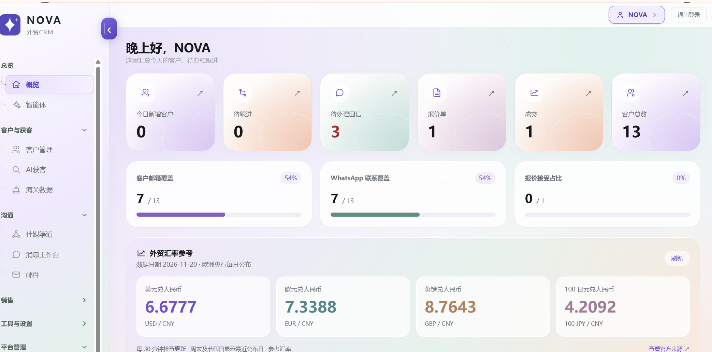
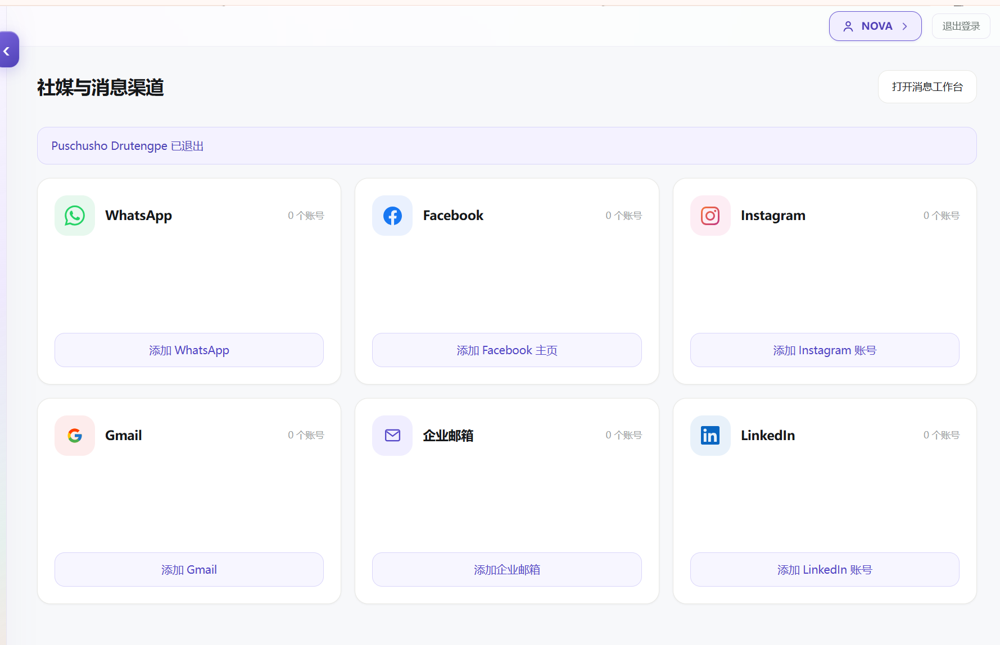
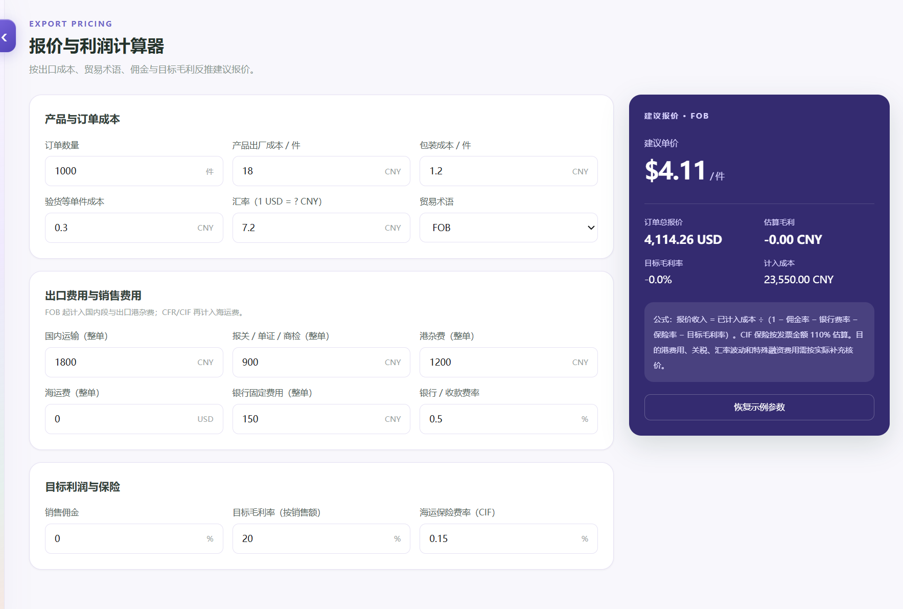

<div align="center">
  
  <h1>NOVA 外贸 CRM</h1>
  <p><strong>让客户管理、销售跟进与多渠道沟通，在一个工作平台中顺畅协作。</strong></p>
</div>

## 功能截图与说明

### 工作总览与销售指标



集中呈现新增客户、待跟进、待处理回信、报价、成交与客户总数，并显示客户联系覆盖率和汇率参考，帮助团队快速安排当日工作。

### AI 智能体


用自然语言查询客户、按国家或行业筛选、创建客户、调整跟进状态、查询报价与统计，减少在多个页面间切换。

### 社媒渠道连接



管理 WhatsApp、Facebook、Instagram、Gmail、企业邮箱和 LinkedIn 等渠道连接。实际可用能力取决于账号授权、服务配置及平台政策。

### 报价与利润计算器



录入订单数量、产品和包装成本、出口费用、汇率、贸易术语、佣金及目标毛利率，估算建议报价、订单金额和预计毛利。正式报价仍应结合实际合同、汇率与物流费用确认。

## 产品功能

- **客户关系管理：**客户档案、联系人、销售阶段、跟进和统计。
- **AI 获客：**按产品关键词发现潜在企业线索，并将合适资料加入客户管理流程；企业名录不代表当前采购意向。
- **销售工作台：**待跟进、高意向、待回复、趋势与转化漏斗。
- **多渠道沟通：**连接支持的社媒和邮箱渠道，在消息工作台处理会话。
- **AI 获客与智能体：**搜索企业资料，以自然语言查询或协助处理销售任务。
- **报价与产品：**维护产品并估算出口成本、建议售价和目标利润。
- **知识与市场工具：**整理业务知识，查询海关统计和外贸汇率参考。
- **团队协作：**管理员创建员工账号并分配模块权限。

## Logo 与登录

Logo 文件：[`public/nova-logo.png`](public/nova-logo.png)。登录界面使用 NOVA 品牌视觉。


## 部署

支持部署到企业自有 Linux 服务器，通过域名和 HTTPS 访问。请参阅 [`SELF-HOSTING.md`](SELF-HOSTING.md) 配置 Docker Compose、域名、首次授权、管理员、反向代理、备份与升级。默认容器端口为 `3000`，建议通过 Nginx 或 Caddy 代理公网 HTTPS 请求。

```bash
cp .env.example .env
# 按 SELF-HOSTING.md 填写域名与初始化配置
docker compose up -d --build
```

社媒、邮箱与 AI 模型需要按部署环境配置相应账号和授权。WhatsApp 中转及共享获客搜索需 NOVA 主站服务可用；真实消息收发还依赖公网 HTTPS 回调和第三方平台权限。

## 技术栈

Next.js 15、React 19、TypeScript、SQLite、Docker Compose、Node.js 22。

## 许可证

本项目采用 [MIT License](LICENSE)，允许复制、修改、部署、再分发及商用。再分发时须保留版权声明和许可证文本。第三方依赖、字体、图标、图片与外部服务仍须遵守各自许可证或服务条款。

版权方：KUMIiun · [manshuang920@gmail.com](mailto:manshuang920@gmail.com)

